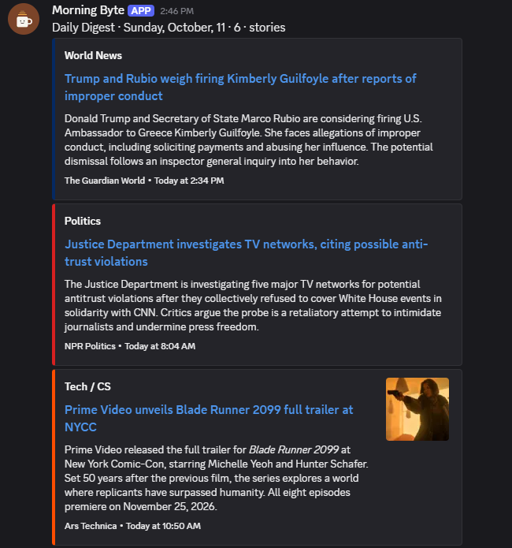

# Daily Digest

[](https://github.com/josephsluterbeck/daily-digest/actions/workflows/tests.yml)

A free, self-running news digest for Discord. Every morning it pulls articles from RSS feeds, picks the best story in each category, summarizes it with AI, and posts one short message you can read without leaving Discord.



## Features

- **One story per category.** Seven categories, seven stories, one notification a day.
- **AI summaries.** Each article is downloaded and summarized in 2–3 plain sentences using Google Gemini's free tier.
- **Graceful fallbacks.** If the AI call fails, it uses the article's opening sentences; if the article can't be downloaded, it uses the feed's own summary. The digest always sends.
- **Smart picking.** Filters to the last 24 hours, removes duplicate stories across feeds (by link, ignoring tracking parameters, and by title), and ranks by keyword matches and source weight.
- **Fully configurable.** Sources, categories, keywords, weights and colors all live in one `config.yaml`.
- **Visible failures.** Broken feeds and unavailable AI summaries are flagged right in the Discord message.
- **Runs for free.** A scheduled GitHub Actions job.
- **Tested.** Unit tests for filtering, deduplication and ranking run on every push.

## How it works

```
fetch feeds → keep last 24h → dedupe → pick best per category → summarize → post to Discord
```

| File | What it does |
|---|---|
| `digest/fetch.py` | Downloads and parses RSS/Atom feeds with feedparser |
| `digest/filter.py` | Drops old or undated items and removes duplicates |
| `digest/rank.py` | Scores items and picks the best one per category |
| `digest/summarize.py` | Extracts article text (trafilatura) and summarizes it (Gemini) |
| `digest/post.py` | Sends the message to a Discord webhook within Discord's limits |
| `digest/main.py` | Runs the whole pipeline; `--dry-run` prints instead of sending |
| `config.yaml` | Sources, categories, keywords and settings |

## Set up your own copy

You'll need a GitHub account, a Discord server where you can create webhooks, and a Google account.

### 1. Fork and clone

Fork this repo on GitHub, then:

```bash
git clone https://github.com/josephsluterbeck/daily-digest.git
cd daily-digest
python -m venv .venv
source .venv/bin/activate          # Windows: .venv\Scripts\activate
pip install -r requirements.txt
```

### 2. Create a Discord webhook

In Discord, open the channel you want the digest in → **Edit Channel → Integrations → Webhooks → New Webhook → Copy Webhook URL**.

### 3. Get a free Gemini API key

Go to [Google AI Studio](https://aistudio.google.com/apikey), sign in, and create an API key. 

### 4. Add your secrets locally

Create a file named `.env` in the repo root (it's already in `.gitignore`):

```
DISCORD_WEBHOOK_URL=https://discord.com/api/webhooks/...
GEMINI_API_KEY=your-gemini-key
```

### 5. Try it

```bash
cd digest
python main.py --dry-run    # prints the message, sends nothing
python main.py              # posts to Discord
```

### 6. Schedule it with GitHub Actions

1. In your fork, go to **Settings → Secrets and variables → Actions** and add two repository secrets: `DISCORD_WEBHOOK_URL` and `GEMINI_API_KEY`.
2. Open the **Actions** tab and enable workflows.
3. Run **Daily Digest → Run workflow** once to test it. Tick **dry_run** to print without sending.

The digest then runs every day at 11:37 UTC. To change the time, edit the `cron` line in `.github/workflows/digest.yml` (times are in UTC).

> GitHub pauses scheduled workflows in public repos after 60 days without commits. If the digest stops arriving, re-enable it from the Actions tab.

## Customizing `config.yaml`

### Add a source

Any RSS or Atom feed works. Add an entry under `sources`:

```yaml
  - name: Ars Technica                # shown in the embed footer
    url: https://feeds.arstechnica.com/arstechnica/index
    category: tech                    # must match an id under `categories`
    weight: 1.0                       # higher = preferred when ranking
    color: "#FF4E00"                  # embed color; keep the quotes
```

**Finding a feed URL:** try `/feed`, `/rss`, `/rss.xml` or `/atom.xml` on the site, or view the page source and search for `application/rss+xml`.

**Sites without a feed** can often be covered with a Google News search feed, for example:
`https://news.google.com/rss/search?q=when:24h+site:example.com&ceid=US:en&hl=en-US&gl=US`

**Tip:** give each category at least two sources. If one feed is quiet or blocked, the category still shows up. Sites that block automated downloads or build pages with JavaScript still work, but fall back to the feed's own summary.

### Categories

The order here is the order in the Discord message. The left side is the id sources refer to; the right side is the label shown on the embed.

```yaml
categories:
  world: World News
  tech: Tech / CS
```

### Keywords

Articles mentioning these words rank higher within their category. A match in the title counts double; the total is multiplied by the source's weight. Matching is case-insensitive and whole-word.

```yaml
keywords:
  python: 1
  cuda: 2
```

### Other settings

```yaml
max_items: 7          # max stories per message (Discord allows 10)
max_age_hours: 24     # ignore anything older than this

summary:
  model: gemini-3.1-flash-lite   # any free Gemini Flash-Lite model
  max_chars: 400                 # longest summary allowed
```

If Google retires the model, summaries fall back to article leads and the digest shows a warning. Pick a current model in AI Studio and update `model`.

## Running the tests

```bash
pip install -r requirements-dev.txt
pytest -v
```

## Built with

Python 3.12 · [feedparser](https://github.com/kurtmckee/feedparser) · [trafilatura](https://github.com/adbar/trafilatura) · [Google Gemini API](https://ai.google.dev/) · Discord webhooks · GitHub Actions